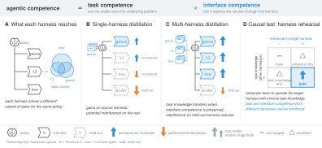
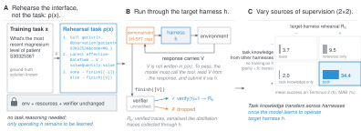

<h3 align="center">Learning <em>What</em> vs. Learning <em>How</em></h3>
<h2 align="center">Decomposing Task and Interface Competence in Agentic Training</h2>

<p align="center">
  <a href="https://arxiv.org/abs/XXXX.XXXXX"></a>
  
</p>

<p align="center"></p>

LLM agents act through a **harness**: the interface through which a model interacts with its environment. The harness shapes what the model sees, how it can act, and the constraints under which it operates. As a result, knowing how to solve a task does not necessarily mean being able to execute that solution in a given harness.

We decompose agentic competence into two components that can be learned, transferred, and lost independently:

- **Task competence**: the knowledge and reasoning needed to solve a task. We find that this can transfer across harnesses.
- **Interface competence**: the ability to express and execute a solution through a particular harness. We find that this is largely harness-specific.

To disentangle task and interface supervision, we introduce *harness rehearsal*: distillation on traces that contain little task-specific information but still require correct use of the target harness. This gives us interface supervision with little task supervision, so we can measure the effects of each alone and together.

This repository contains the code, data, and results for the experiments in [the paper](https://arxiv.org/abs/XXXX.XXXXX). We study four questions:

1. **Harness dependence.** We run the same frozen model through different harnesses. The harness changes both overall performance and which tasks the model solves.

2. **Cross-harness transfer.** Distillation on one harness can improve performance on that harness while hurting others. Training on several harnesses transfers better, including to a held-out harness.

3. **Task vs. interface supervision.** We isolate interface learning with *harness rehearsal*: traces that contain little task-specific information but still require the target harness to be used correctly. On BFCL multi-turn with Qwen3-4B, rehearsal alone scores 32.5 and task supervision alone scores 8.5, while combining them reaches 58.8.

4. **Interface competence under RL.** After multi-harness distillation, single-harness GRPO does not reproduce the same cross-harness collapse and can improve performance on a held-out harness.

<p align="center"></p>

**Setup.** We evaluate on MedAgentBench, Reasoning Gym, BFCL (single-turn and multi-turn), and AppWorld, each with three training harnesses and one held-out harness. All use the same [harbor](https://github.com/harbor-framework/harbor) execution framework, isolating interface differences. We distill verified traces from Qwen3-32B into Qwen3-4B, then train with GRPO using the same harnesses and verifiers. We also replicate key results with Gemma-3-4B-it.

**Run experiments.** The `exp` CLI runs the experiments end to end: task generation, training from the provided datasets, serving, evaluation, and result tables. It requires GPUs and a sandbox backend: Docker on a single machine, or Kubernetes. `exp table --format cells` writes results in the same schema as `results/cells.csv`, and `exp table --shipped` prints the shipped results without running anything.

```bash
setup/install.sh                                     # harbor, SkyRL, the SFT environment, the exp CLI
uv run exp list experiments                          # the twelve experiments
uv run exp run specialists-vs-3h --backend docker    # one experiment, end to end
uv run exp table specialists-vs-3h                   # its table, from your runs (--shipped: the reported one)
```

## Experimental Settings

- **Base model evaluation**
  - **base policy** (`base`) — the released model, evaluated through every harness
  - **teacher** (`teacher`) — the larger model used to produce the distillation traces
- **Supervised training** — students trained on verified teacher traces
  - **single-harness** (`<h>-only`) — traces from one training harness
  - **multi-harness** (`3h`) — traces from all three training harnesses
  - **volume-matched** (`3h-n108`, `3h-n150`, ...) — smaller multi-harness datasets matched to a single-harness dataset's size
- **Rehearsal** — separates task supervision from learning to use the target harness
  - **cross-task** (`<h1>+<h2>`) — task supervision through the other two harnesses
  - **rehearsal-only** (`reh-<h>`) — tasks where the instruction gives the solution steps, leaving the model to carry them out through the target harness
  - **cross-task + rehearsal** (`<h1>+<h2>+reh-<h>`) — both together
- **Reinforcement learning**
  - **multi-harness** (`grpo-3h`) — GRPO rollouts from all three training harnesses
  - **single-harness** (`grpo-<h>`) — GRPO rollouts from one harness

The names in parentheses are the setting names used in the `arm` column of `results/cells.csv`; the naming scheme is documented in `results/README.md`. For supervised settings, the same name is used for `benchmarks/<benchmark>/pools/<setting>.jsonl` and `--pool`. `base` selects the released model. The teacher uses `--teacher`. For RL, `grpo-<x>` is trained with `exp grpo --rollout <x>` and served with `--rl <x>`.

Every setting is evaluated on the benchmark's three training harnesses and one held-out harness.

## Running an experiment

Each experiment has a name, and `exp run` executes the full sequence:

```bash
uv run exp list experiments                                  # every experiment, its benchmarks and what it compares
uv run exp plan specialists-vs-3h --backend docker           # print its script: every command it will run, in order
uv run exp run specialists-vs-3h --backend docker --dry-run  # write that script to runs/plans/ without running it
uv run exp run specialists-vs-3h --backend docker            # write it and run it, end to end
```

The script generates the required tasks, trains the checkpoints it needs, serves and evaluates them, and finishes with `exp table`. [docs/COMMANDS.md](docs/COMMANDS.md#what-each-experiment-runs) lists the exact work done by each experiment and which checkpoints are shared.

Completed checkpoints are reused rather than retrained; pass `--force` to retrain. Run experiments one at a time, since two experiments may try to write the same checkpoint.

## How commands compose

```bash
uv run exp <command> --benchmark <benchmark> --model <model> [--pool <arm> | --rl <arm>] [--harness <set>]
```

- `tasks` builds task directories; `collect` and `build-pool` produce training data; `sft` and `grpo` train; `serve` starts a model server; `eval` runs evaluation; and `table` rebuilds results from completed runs or the reported values.
- `--pool` selects a supervised setting: `base`, a single-harness or multi-harness dataset, a volume-matched setting, or a rehearsal condition.
- `--rl` selects a trained RL setting for evaluation. `grpo --rollout` chooses the harness set used during RL training. All RL settings start from the multi-harness SFT checkpoint.
- `--harness` selects the evaluation harnesses: all trained harnesses, one harness, the held-out harness, or all of them.
- Sampling settings, attempts per task, and interaction budgets live in the configs rather than command-line flags.
- `uv run exp list` shows the available benchmarks, datasets, models, and experiments.

## Example

This reproduces one cell: the multi-harness MedAgentBench student evaluated through the benchmark's native harness.

It assumes `setup/install.sh` has been run and `.env` is configured. `CKPT` should point to a multi-harness checkpoint, either trained with `uv run exp sft` or supplied separately.

```bash
# task directories for the evaluation split
uv run exp tasks -b medagentbench --split test

# serve the checkpoint with this setting's reported flags (one GPU), in its own process
# group so `exp stop` can stop all of it
setsid uv run exp serve -b medagentbench --model qwen3-4b --pool 3h --checkpoint "$CKPT" --port 8000 & SERVER=$!
uv run exp wait --api-base http://127.0.0.1:8000/v1 --pid $SERVER

# evaluate through the native harness; sandboxes reach the server on the host IP
# (this ran on Kubernetes with --backend eidf; on a single machine use --backend docker)
uv run exp eval -b medagentbench --model qwen3-4b --pool 3h --harness parity \
  --backend eidf \
  --api-base http://127.0.0.1:8000/v1 \
  --sandbox-api-base "http://$POD_IP:8000/v1"   # POD_IP: set by setup/eidf/session.sh

# stop the server and wait until the GPU is free
uv run exp stop --pid $SERVER
```

Output example:

```text
244/244 Mean: 0.680 ──────────────────────────────── 0:41:14 0:00:00

test · medagentbench-trainable-agent · policy
┌────────┬────────────┬───────┬────────┬────────┐
│ Trials │ Exceptions │  Mean │ Pass@2 │ Pass@4 │
├────────┼────────────┼───────┼────────┼────────┤
│    239 │          5 │ 0.680 │  0.754 │  0.787 │
└────────┴────────────┴───────┴────────┴────────┘

┌────────┬───────┐
│ Reward │ Count │
├────────┼───────┤
│ 1.0    │   166 │
│ 0.0    │    73 │
└────────┴───────┘

┌─────────────────────────┬───────┐
│ Exception               │ Count │
├─────────────────────────┼───────┤
│ RuntimeError            │     4 │
│ RewardFileNotFoundError │     1 │
└─────────────────────────┴───────┘

Total runtime: 41m 15s
```

## Evaluation

The table below summarises the evaluation setup. Full commands for each experiment are in [docs/COMMANDS.md](docs/COMMANDS.md), and file locations and dependencies are documented in [docs/PATHS.md](docs/PATHS.md).

| Axis | Values | How |
|---|---|---|
| benchmark | `medagentbench`, `reasoning_gym`, `bfcl_singleturn`, `bfcl_multiturn`, `appworld` | `-b` |
| harness | each benchmark's training harnesses **plus one held-out harness no training stage ever uses** | `--harness trained \| heldout \| <h> \| all` |
| split | `test`; Reasoning Gym also has `test-hard` | `--split` |
| metric | mean verifier reward (reliability) and pass@n (access) | reported together |
| model | `qwen3-4b`; a `gemma-3-4b-it` replication for two benchmarks | `-m` |
| protocol | four attempts per task (BFCL single-turn: one greedy attempt); sampling temperature and interaction budgets fixed per benchmark | in the configs, not flags |

Training and held-out harnesses:

| Benchmark | Trained | Held out |
|---|---|---|
| MedAgentBench | `parity`, `t2`, `fc` | `xml` |
| Reasoning Gym | `t2`, `miniswe`, `goose` | `aider` |
| BFCL single-turn | `fc`, `json`, `t2` | `xml` |
| BFCL multi-turn | `fc`, `json`, `pycall` | `xml` |
| AppWorld | `code`, `fc`, `mini` | `xml` |

Rewards come directly from each benchmark's verifier, with no shaping for trajectory length, number of turns, or termination. MedAgentBench, BFCL, and AppWorld use binary rewards. Reasoning Gym uses scores in `[0,1]`.

<!--
## To do

- [ ] More student models. Qwen3.5 support is in progress.
- [ ] AppWorld: harness rehearsal and GRPO. Only the harness-dependence and cross-harness transfer experiments cover it so far.
- [ ] Gemma-3-4B-it on BFCL and AppWorld.
- [ ] Experiments at larger scale: more training tasks and larger students.
- [ ] Citation entry and arXiv link.

## Citation

The paper is not on arXiv yet. A BibTeX entry will be added here once it is.
-->
